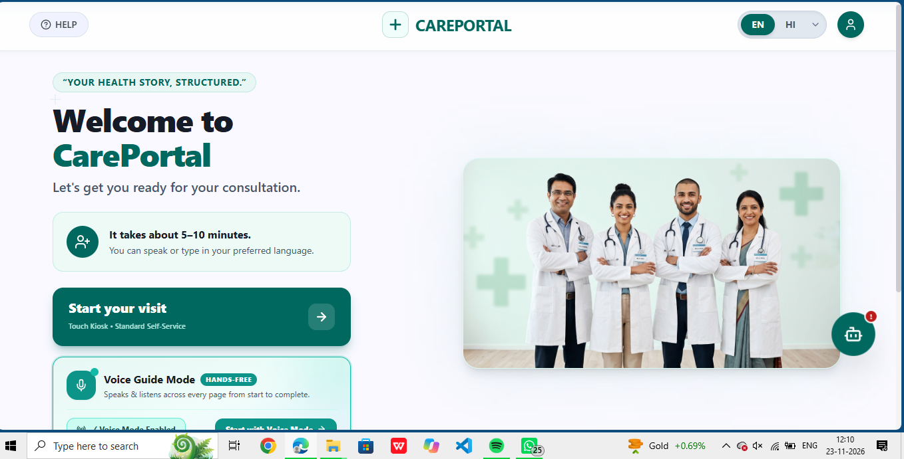
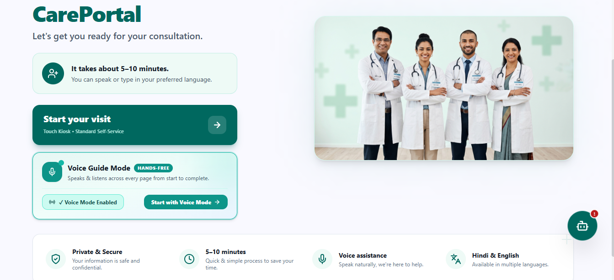
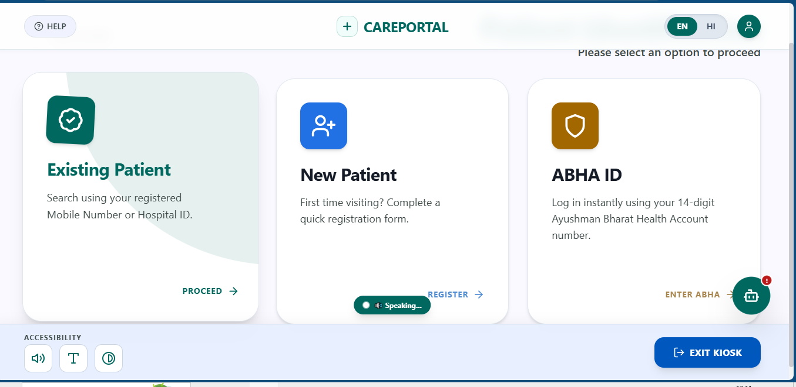
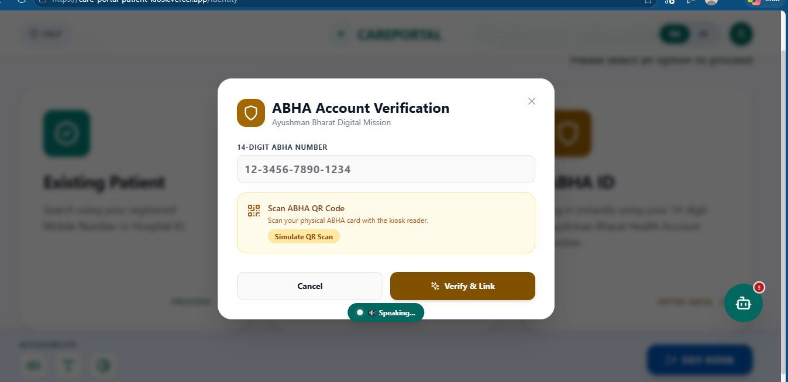
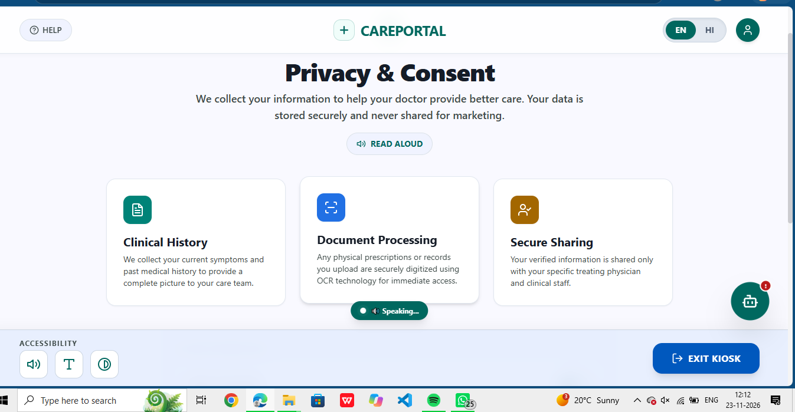
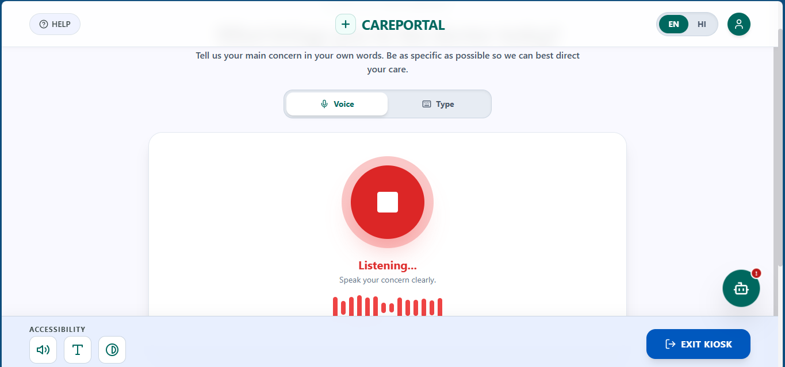
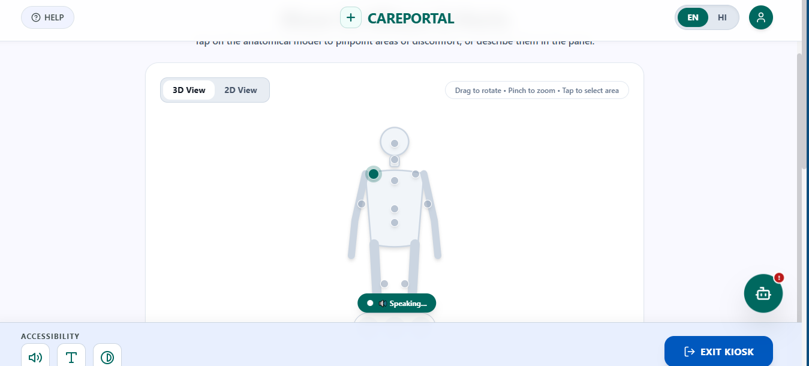
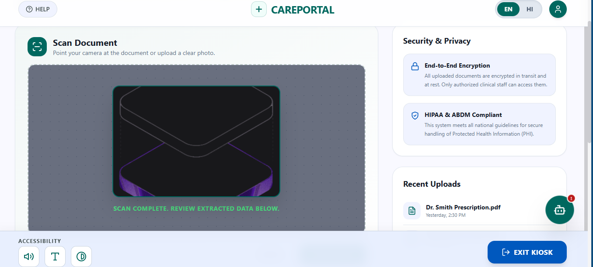

# SANJEEVANI CareAI – Patient Kiosk System

**Your Health Story, Structured.**

SANJEEVANI CareAI is an AI-assisted patient intake and medical history collection platform designed to simplify hospital registration and improve the flow of information between patients and doctors.

The platform provides a guided kiosk experience where patients can register, share symptoms, map pain locations, upload medical documents, and provide their medical history before consultation.

---

## Screenshots

### 1. Welcome Screen


### 2. Voice Guide Mode


### 3. Patient Selection


### 4. ABHA Account Verification


### 5. Privacy and Consent


### 6. Voice-Based Symptom Input


### 7. Interactive Body Pain Mapping


### 8. Medical Document Scanning


---

## Key Features

### Patient Kiosk
- AI-powered MediBot assistant.
- English and Hindi language support.
- Existing patient and new patient registration.
- ABHA ID-based patient identification.
- Mobile OTP verification.
- Privacy and consent management.
- Voice and text-based symptom collection.
- Interactive 2D/3D body pain mapping.
- Pain intensity selection (1–10).
- Medical document upload and scanning.
- Medical history collection.
- Family medical history tracking.
- Responsive user interface.
- Voice guidance and accessibility controls.

### Doctor Dashboard
- Real-time patient queue.
- AI-generated clinical summaries.
- Red-flag alerts for priority patients.
- Doctor management.
- Admin panel.
- Patient information management.

---

## Patient Journey

```text
1. Welcome Screen
       |
2. Language Selection (English / Hindi)
       |
3. Patient Identification
       |
   +---+----------------+
   |                    |
Existing Patient    New Patient
   |                    |
   +--------+-----------+
            |
4. ABHA ID Verification (where applicable)
            |
5. Privacy and Consent
            |
6. Symptom Description
   (Voice / Text)
            |
7. Body Pain Mapping
   (2D / 3D)
            |
8. Medical History
            |
9. Document Upload
            |
10. Family Medical History
            |
11. Registration Complete
            |
12. Doctor Dashboard
```

**Estimated completion time:** 5–10 minutes.

---

## Technology Stack

| Component | Technology |
|---|---|
| Frontend | Next.js 14 |
| UI Library | React 18 |
| Language | TypeScript |
| Styling | Tailwind CSS |
| Animations | Framer Motion |
| Database | Supabase PostgreSQL |
| Authentication | Supabase Auth |
| Storage | Supabase Storage |

---

## Project Structure

```text
SIH 2.O/
│
├── apps/
│   ├── patient-kiosk/
│   │   ├── app/
│   │   ├── components/
│   │   └── lib/
│   │
│   └── doctor-dashboard/
│
├── database/
│
├── packages/
│
├── screenshots/
│   ├── 01-welcome-screen.png
│   ├── 02-welcome-and-voice-guide.png
│   ├── 03-patient-type-selection.png
│   ├── 04-abha-verification.png
│   ├── 05-privacy-and-consent.png
│   ├── 06-symptom-voice-input.png
│   ├── 07-body-pain-mapping.png
│   ├── 08-document-scanning.png
│   └── 09-document-processing.png
│
├── .env.example
├── README.md
├── INSTALLATION.md
├── START_HERE.md
├── SUPABASE_SETUP.md
├── PATIENT_FLOW_COMPLETE.md
└── CREDENTIALS_REFERENCE.md
```

---

## Getting Started

### Prerequisites

- Node.js
- npm
- Supabase account
- Git

### 1. Clone Repository

```bash
git clone <YOUR_GITHUB_REPOSITORY_URL>
cd <PROJECT_FOLDER>
```

### 2. Configure Environment Variables

Create `.env.local` files in the required application directories.

Use `.env.example` as a reference and configure your Supabase credentials.

```env
NEXT_PUBLIC_SUPABASE_URL=your_supabase_url
NEXT_PUBLIC_SUPABASE_ANON_KEY=your_supabase_anon_key
```

Use the actual variable names expected by your application.

### 3. Database Setup

Open Supabase Dashboard → SQL Editor.

Run the required database scripts:

```text
database/disable_rls_for_dev.sql
database/add_new_features.sql
```

Refer to `SUPABASE_SETUP.md` for detailed instructions.

### 4. Start Patient Kiosk

```bash
cd apps/patient-kiosk
npm install
npm run dev
```

Open:

```text
http://localhost:3000
```

### 5. Start Doctor Dashboard

Open another terminal:

```bash
cd apps/doctor-dashboard
npm install
npm run dev
```

Open:

```text
http://localhost:3001
```

---

## Demo Credentials

**Admin Login**

```text
Email: admin@hospital.com
Password: Admin@123
```

**Doctor Login**

```text
Email: dr.sharma@hospital.com
Password: Doctor@123
```

**Patient OTP (Development Mode)**

```text
Mobile: Any 10-digit number
OTP: 123456
```

These are development credentials only. Replace them before deployment.

---

## Database Tables

| Table | Description |
|---|---|
| patients | Basic patient information |
| patient_sessions | Registration sessions |
| clinical_histories | Symptoms and medical history |
| pain_locations | Body pain information |
| family_medical_history | Family health records |
| previous_records | Uploaded medical documents |
| consent_tracking | Patient consent records |
| user_profiles | Doctor and user profiles |
| queue_items | Patient queue management |

---

## Documentation

| File | Description |
|---|---|
| START_HERE.md | Quick project introduction |
| INSTALLATION.md | Installation instructions |
| SUPABASE_SETUP.md | Database configuration |
| PATIENT_FLOW_COMPLETE.md | Patient journey |
| CREDENTIALS_REFERENCE.md | Demo credentials |
| QUICK_LANGUAGE_GUIDE.md | Language setup |
| LANGUAGE_IMPLEMENTATION.md | Language implementation |
| DEBUG_LANGUAGE.md | Language troubleshooting |

---

## Security Considerations

- Configure Row Level Security (RLS) before production.
- Implement proper authentication and authorization.
- Replace mock OTP with a real verification service.
- Protect sensitive patient information.
- Secure uploaded medical documents.
- Never expose private API keys or service-role keys.
- Use HTTPS for production deployment.
- Implement appropriate access controls for doctors and administrators.

**Note:** Development configurations, including disabled RLS and mock OTP, must not be used with real patient data.

---

## Future Enhancements

- Advanced 3D anatomical model using Three.js.
- Real AI integration using OpenAI or Gemini.
- OCR-based medical document extraction.
- Automated clinical data extraction.
- Offline kiosk support.
- Improved interoperability with digital health records.

---

## Testing Checklist

- [ ] Patient registration works.
- [ ] OTP verification works in development mode.
- [ ] English and Hindi language switching works.
- [ ] MediBot responds to user queries.
- [ ] Voice input works.
- [ ] Pain mapping accepts selections.
- [ ] Medical document upload works.
- [ ] Patient data is saved in Supabase.
- [ ] Doctor dashboard displays patient information.
- [ ] Responsive design works across devices.

---

## Project Information

**Project Name:** SANJEEVANI CareAI  
**Version:** 2.0.0  
**Category:** Healthcare Technology / AI-Assisted Patient Management  
**Project Type:** SIH Project and Mini Project

---

## License

Add an appropriate license before publicly distributing this project.

---

**SANJEEVANI CareAI – Making Patient Registration Smarter, Simpler and More Accessible.**
